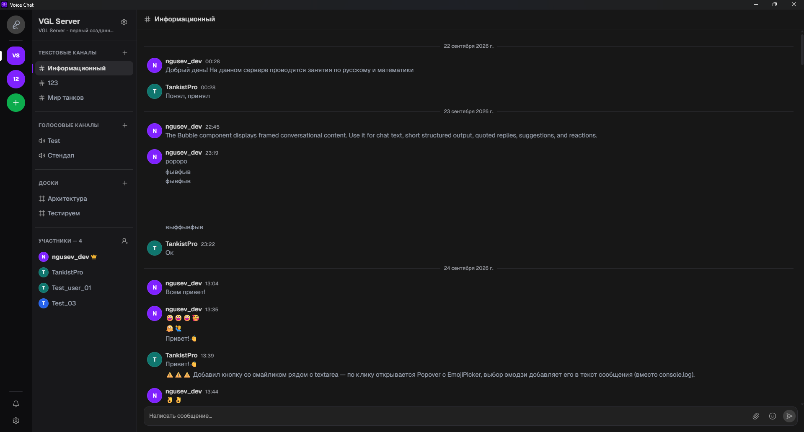
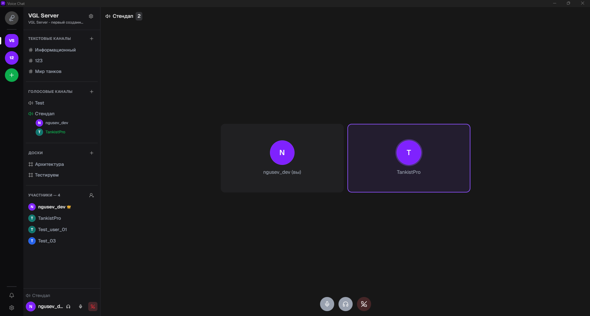
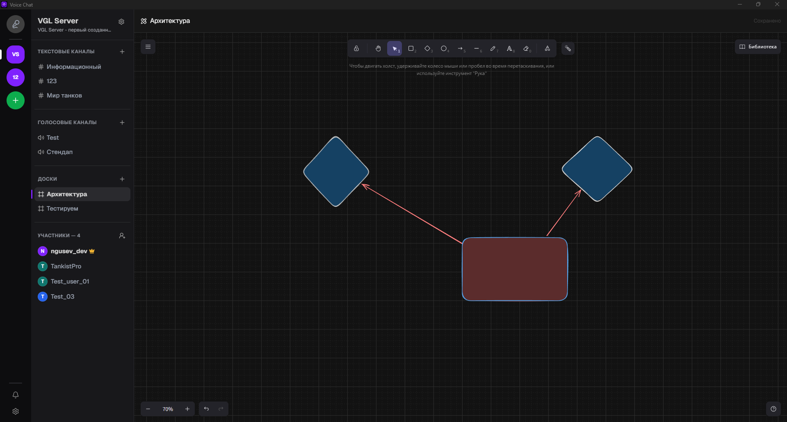
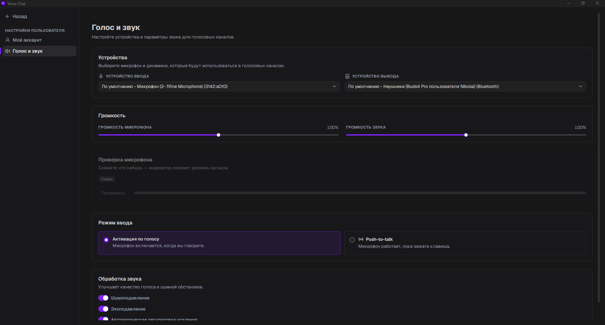

# VoiceChat

**Мессенджер для команд и сообществ: серверы, текстовые и голосовые каналы, совместные доски.**

 

&nbsp;

  

## ✨ Возможности

<table>
  <tr>
    <td width="50%" valign="top">
      <h3>🏰 Серверы</h3>
      Создавайте сообщества, приглашайте участников и управляйте ролями и правами.
    </td>
    <td width="50%" valign="top">
      <h3>💬 Текстовые каналы</h3>
      Сообщения в реальном времени, редактирование, эмодзи и группировка по дням.
    </td>
  </tr>
  <tr>
    <td width="50%" valign="top">
      <h3>🎙️ Голосовые каналы</h3>
      Видно, кто сейчас в канале; микрофон и звук включаются в один клик.
    </td>
    <td width="50%" valign="top">
      <h3>🖌️ Совместные доски</h3>
      Бесконечный холст прямо внутри сервера: рисуйте вместе и видите курсоры друг друга.
    </td>
  </tr>
  <tr>
    <td width="50%" valign="top">
      <h3>🔔 Уведомления</h3>
      Приглашения и новые сообщения приходят мгновенно, в том числе системными уведомлениями.
    </td>
    <td width="50%" valign="top">
      <h3>🔐 Безопасность</h3>
      Данные входа хранятся в системном хранилище ключей или в зашифрованном файле, а не в браузере.
    </td>
  </tr>
</table>

## 📸 Скриншоты

<table>
  <tr>
    <td width="50%">
      
      
<b>Голосовой канал</b>

    </td>
    <td width="50%">
      
      
<b>Совместные доски</b>

    </td>
  </tr>
  <tr>
    <td width="50%">
      
      
<b>Текстовый чат</b>

    </td>
    <td width="50%">
      
      
<b>Голос и звук</b>

    </td>
  </tr>
</table>

## 📦 Установка

| Платформа | Файл | Требования |
| :-- | :-- | :-- |
| 🪟 **Windows** | `…_x64-setup.exe` или `…_x64_en-US.msi` на странице [последнего релиза](https://github.com/voice-chat-team/voice-chat-releases/releases/latest) | Windows 10 / 11, 64-бит |
| 🤖 **Android** | [`voice-chat-android.apk`](https://github.com/voice-chat-team/voice-chat-releases/releases/latest/download/voice-chat-android.apk) | Android 7.0 и новее |

<b>🪟 Windows: как установить</b>

 

1. Скачайте `…-setup.exe` со страницы [последнего релиза](https://github.com/voice-chat-team/voice-chat-releases/releases/latest).
2. Запустите установщик и следуйте подсказкам.
3. Если появится окно **«Windows защитила ваш компьютер»**, нажмите **«Подробнее» → «Выполнить в любом случае»**: установщик пока не подписан сертификатом издателя.

<b>🤖 Android: как установить</b>

 

1. Скачайте [`voice-chat-android.apk`](https://github.com/voice-chat-team/voice-chat-releases/releases/latest/download/voice-chat-android.apk) на телефон.
2. Откройте файл. Если система спросит, разрешите браузеру или файловому менеджеру **установку из неизвестных источников**.
3. Нажмите **«Установить»**.

Обновление ставится поверх старой версии, данные при этом сохраняются.

## 🆕 Обновления

Новые версии появляются на странице [Releases](https://github.com/voice-chat-team/voice-chat-releases/releases). Чтобы узнавать о них сразу, нажмите **Watch → Custom → Releases** вверху этой страницы.

## 💬 Нашли ошибку?

Опишите проблему в [Issues](https://github.com/voice-chat-team/voice-chat-releases/issues): что делали, что ожидали и что произошло. Укажите версию приложения и платформу, по возможности приложите скриншот.

---

© VoiceChat Team

